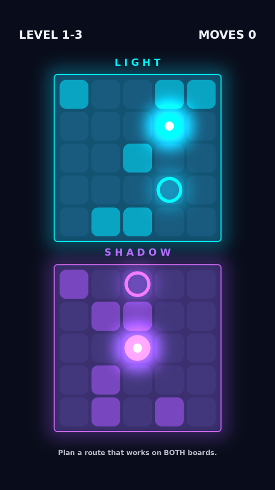

# NEON SHIFT

A portrait 2D neon puzzle game for Android, built with **Unity 2D + C#**.

You control two linked characters at once: cyan **Light** and violet **Shadow**.
Every swipe moves Light in the swipe direction and Shadow in the **opposite** direction.
If either one would hit a wall or a board edge, **neither** moves. Get both onto their own exits to win.



_The image is a layout preview rendered outside Unity, not an in-game screenshot._

## Status: Build 001 (core loop)

Done, following the game plan:

- Two synchronized 5×5 boards, stacked for portrait.
- Swipe input (touch and mouse) plus arrow keys / WASD in the Editor. One gesture is one move; a second finger cancels it; input is locked while tokens animate.
- Paired movement: both destinations are validated first, then both move together.
- Wall and edge collision, with a red "bump" showing which character was blocked.
- Move counter (rejected swipes don't count) and win detection (both on their exits).
- Level-complete panel with Next / Replay, and progress saved locally.
- 8 World 01 levels (4 to 14 moves), each proven solvable by an automated solver.

Next up (Build 002): undo, restart button, move limits, star rating, and deciding on energy nodes.

## Open it in Unity

1. Install **Unity Hub** and a **Unity 6** editor with **Android Build Support**.
2. Clone this repo, then in Unity Hub choose **Add → Add project from disk** and pick the `NeonShift` folder. If Hub asks for an editor version, pick your Unity 6 version.
3. On first open, the project sets portrait Player Settings and creates `Assets/Scenes/Gameplay.unity` automatically. (You can also use the **NEON SHIFT** menu.)
4. Press **Play**. Swipe with the mouse or use the arrow keys. In the Editor, `R` restarts and `N` skips a level.
5. After the first open, commit the `.meta` files Unity creates.

Everything (camera, boards, tokens, text) is created in code by `GameManager`, so the scene can stay empty and the prototype needs no art files.

## Play it on an Android phone

File → Build Profiles (Build Settings) → Android → Switch Platform. Set a package name in Player Settings (for example `com.yourname.neonshift`), connect the phone with USB debugging on, and choose **Build And Run**. Use APK for testing, AAB for the Play Store.

## Project layout

```
Assets/
  Editor/NeonShiftProjectSetup.cs   portrait settings + scene creation
  Resources/Levels/World01/*.json   level files (format below)
  Scripts/
    Core/      GameManager, GameState, GridPos, Direction
    Levels/    LevelData, LevelLoader, LevelManager
    Grid/      BoardState, BoardRenderer
    Player/    PlayerController (token visuals and animation)
    Input/     SwipeInput
    Movement/  MovementManager, CollisionChecker
    Puzzle/    PuzzleState (the rules), PuzzleSolver (shortest solution)
    UI/        GameplayUI, WorldButton, NeonTheme, NeonSprites
    Save/      SaveManager
Tests/CoreTests.cs        rule tests that run without Unity
tools/run-core-tests.sh   compiles and runs the tests with Mono
tools/generate_levels.py  helper that searches for new levels
```

The rule code (`GridPos`, `Direction`, `LevelData`, `BoardState`, `CollisionChecker`, `PuzzleState`, `PuzzleSolver`) does not use `UnityEngine`, so it can be tested anywhere.

## Level format

Example (level 3, wall lists shortened):

Coordinates are `x` = column (0 = left) and `y` = row (**0 = top**).

```jsonc
{
  "levelId": 3, "worldId": 1, "gridWidth": 5, "gridHeight": 5,
  "maxMoves": 11,
  "hint": "Plan a route that works on BOTH boards.",
  "light":  { "start": {"x":3,"y":1}, "exit": {"x":3,"y":3}, "walls": [{"x":0,"y":0}] },
  "shadow": { "start": {"x":2,"y":2}, "exit": {"x":2,"y":0}, "walls": [{"x":1,"y":1}] },
  "energyNodes": [],
  "starThresholds": { "threeStarsMaxMoves": 6, "twoStarsMaxMoves": 8, "oneStarMaxMoves": 11 },
  "_solution": "LLDDRR"
}
```

`maxMoves` and `starThresholds` are stored for Build 002 and not enforced yet. `_solution` is a known shortest solution kept for QA; the game ignores it.

**Design note:** with the "both or neither" rule, Light's total movement is always the exact mirror of Shadow's. So in every level, `light.exit − light.start` must equal `shadow.start − shadow.exit`, otherwise it can't be solved. The tests check every level.

## Tests

```
sudo apt install mono-devel   # once
tools/run-core-tests.sh
```

They check all four directions, Light-blocked and Shadow-blocked cases, board edges, the move counter, the win rule, and that every shipped level is valid and solvable.

## Make new levels

```
python3 tools/generate_levels.py <seed> <target_moves> [count]
```

It prints random 5×5 levels whose shortest solution is exactly `target_moves` and needs a detour. Copy a good one into a JSON file, then run the tests.
